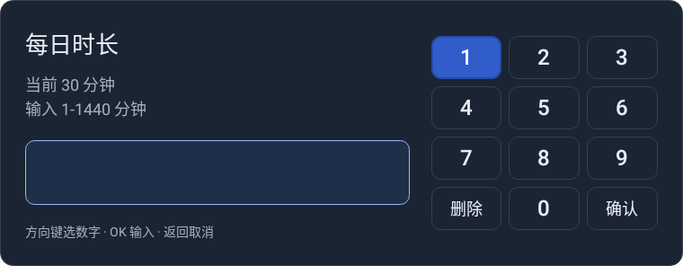

# TV Kids Guard · 电视时长管控

给安卓电视设置每天能看的时长。默认 30 分钟，用完自动锁屏，家长用遥控器管理。

[下载 APK](https://github.com/zzusec/tv-kids-guard/releases/latest/download/tv-kids-guard.apk) · [版本记录](https://github.com/zzusec/tv-kids-guard/releases) · [反馈问题](https://github.com/zzusec/tv-kids-guard/issues)

## 截图

### 家长面板


### 无数字键遥控器输入



### 有实体数字键遥控器输入


### 每天 30 分钟用完后


以上截图均为应用原生渲染预览，使用示例数据。

## 安装

需要 Android 4.4（API 19）及以上，遥控器有方向键、OK 和返回键即可；没有数字键时可使用屏幕数字键盘。

1. 下载 APK，通过 U 盘或 ADB 安装。
2. 首次输入出厂密码 `000000`，再设置自己的 6 位家长密码。
3. 开启悬浮窗、无障碍服务，并允许应用在后台运行。

## 遥控操作

进入家长面板后，用方向键选择操作、按 OK 执行；有数字键的遥控器也可直接输入两位快捷码。

| 快捷码 | 操作 | 说明 |
| --- | --- | --- |
| `00` | 关闭面板 | 只退出页面，不改变防护状态 |
| `11` | 改密码 | 再次验证后设置新密码 |
| `12` | 修改每日时长 | 每天 1–1440 分钟 |
| `13` | 检查更新 | 下载并安装正式版更新 |
| `22` | 临时加时长 | 只加今天，每天累计最多 60 分钟 |
| `33` | 立即锁定 | 马上锁屏，重新按当天额度限时 |
| `44` | 关闭防护 | 确认后停止管控，保留时长和密码 |
| `55` | 开启防卸载 | 启用设备管理员，增加直接卸载限制；仍需设置保护 |
| `99` | 启用防护 | 恢复普通管控，仅停用时显示 |

- 输入方式：把所有非虚拟键盘或方向键 `InputDevice` 的数字键能力**合并**判断——各设备报告的普通数字键与小键盘数字键并集覆盖 0–9 就隐藏屏幕数字盘，只显示实体输入区；并集缺一字或检测结果未知时显示数字盘，不按电视或遥控器品牌判断。
- 实测优先：一旦有数字按键真的从非虚拟设备送达（哪怕它的 keymap 没报数字键），就在本机 `tvguard_remote` 记下 `physical_digits_seen`，此后收起数字盘。屏幕数字盘自己产生的按键和虚拟设备不算证据。
- 2.5.13 起没有手动切换：系统 keymap 不一定对应遥控器实际按键，早期版本因此在每个输入页放了「使用屏幕数字盘」「使用遥控器数字键」按钮。实测下来这颗按钮在已经能正常输入时被家长当成多余的选项，于是整颗删除——输入方式只由上面的硬件检测与实测结果决定，任何页面都不再有切换按钮，也不再响应任何组合键来打开数字盘。旧版写在 `tvguard_remote` 里的 `show_keypad`、`pad_pinned` 在升级后第一次读取时被清掉，不会把数字盘留在屏幕上。
- 家长验证与输入弹窗：检测到数字键时默认聚焦输入区，直接按遥控器数字键输入；检测不到时屏幕上就是数字盘，方向键选数字、OK 输入。
- 无数字键：用方向键在屏幕数字盘上选择数字，按 OK 输入；选择屏幕上的「删除」或「确认」按钮，再按 OK 执行。
- 有实体数字键：保留直接输入，输入后左方向键删除、OK 直接确认。
- 返回键取消当前输入。家长密码为 6 位且始终遮罩，时长显示数字，数字盘输入后选择「确认」保存；两种输入方式均不依赖系统输入法（IME）。家长验证、首次设置和修改密码、到时锁屏、每日时长与临时加时都按同一套硬件判定选择其中一种输入方式。

锁屏默认聚焦「家长管理」按钮，按 OK 进入家长验证，验证后打开面板，不自动解除当天限时。数字盘显示时从该按钮按方向下或右进入数字盘；检测到遥控器有数字键时屏幕上没有数字盘，直接按遥控器数字键输入即可，锁屏在任何焦点位置都收得到数字。在锁屏上直接输入家长密码并确认，同样只打开家长管理面板：密码只证明家长在场，不送出一天的时长，锁屏仍在面板之下，离开面板即恢复。返回取消输入不会解除锁定。想让孩子多看一会儿，只能用管理面板的 `22 临时加时长` 或 `12 修改每日时长`，两者都不清空今天已看时长。

## 注意

- 防护开启时按亮屏时间计时，不是视频播放时长；关屏、待机和锁定时都暂停，次日清零。遥控器待机后挂钟仍会继续走，但这段时间不计入当天额度；即使某个计时周期被系统卡住，一次也最多补 4 秒。
- 右上角角标是防护仍在运行的凭据：只要没有锁屏就显示「剩余 MM:SS」，最后 5 分钟变红。2.5.12 起不再有「今天不限时」这一状态，角标也就永远不会换成一句「不限时」提示；孩子看不到空白角标，也就不会把它当成「防护关了」。
- 更新请覆盖安装，不要卸载或清除数据。Actions 中的 `community-debug` 包不能覆盖正式版。
- 日常保护依靠家长密码、到时锁屏和无障碍设置拦截：点击图标先验证，进入已识别的设置、应用详情或卸载页面时弹出验证页，返回不会露出原设置页。每次进入设置都要重新输入家长密码，已授权的会话不作为通行证；只有家长验证页或管理面板正在屏幕上、或短时维护授权期间，拦截服务才不动手，因此不会出现「输入密码后又被要求输入密码」的循环。锁屏规则不变：在锁屏输入家长密码只打开家长管理面板，不送出一天的时长；管理面板按 `33 立即锁定` 重新锁屏。
- 无障碍服务重连及定时检查会查询当前窗口所属包名，恢复已打开页面的保护；不遍历控件，不读取、保存或上传界面文字。页面识别失败会重试；面板区分权限未开启、服务未连接和查询失败，不能把启用列表当作实际运行状态。升级后请家长确认无障碍服务正常连接；若被系统关闭，普通应用不能自行重新开启。
- `55 开启防卸载` 是附加保护，由家长在系统确认页启用普通设备管理员。管理员仍启用时，系统拒绝直接卸载，但部分设置页可以先停用管理员再卸载；停用后的密码提示不能撤销该操作。因此必须保持设置拦截正常，不能把普通管理员当成系统级密码卸载锁。
- 本轮不要求 root、刷机、系统预装或 Device Owner。普通保护不保证阻止系统强停、清除数据或厂商未覆盖的卸载入口，安装后须检查实际电视的桌面长按和应用管理入口。
- 关闭防护会解除设备管理员；再次启用防护不会自动恢复该身份，需要重新按 `55`。Android 4.4 同样支持设备管理员，但没有系统 Lock Task，不能承诺系统级防绕过。更新由旧版系统安装器确认，不会静默安装。
- 数据保存在电视本地，无需注册账号；更新需要连接 GitHub。不同厂商的后台限制可能影响计时，请安装后验证。

本轮版本为 2.5.13（versionCode 44），去掉「使用屏幕数字盘」按钮：实机反馈是遥控器本身有数字键、屏幕上却还挂着这颗切换按钮，于是整颗删除。输入方式从此只由硬件决定——非虚拟键盘/方向键设备的数字键并集覆盖 0–9，或本机已经实测到过真实数字键，就用遥控器直接输入并隐藏数字盘；能力缺一字或未知才显示数字盘。验证页、到时锁屏、首次设置与改密码、每日时长、临时加时都不再有切换入口，也没有任何组合键能把数字盘叫出来；旧版写在 `tvguard_remote` 里的 `show_keypad`、`pad_pinned` 在升级后第一次读取时被清除，不会把数字盘留在已具备数字键的电视上。保留 2.5.12 的「家长密码不送时长」、2.5.11 的数字键识别（能力取并集、实测优先）、2.5.10 的待机不计入当天时长，以及 2.5.9 的「每次进入设置都要输入家长密码」及其防死循环。待机统计在 Sony 上仍有漏计嫌疑，正在用实机采样确认，确认后单独出版本修。小米电视 2（MiTV2-40）的实机安装与遥控验收仍待 ADB 恢复后完成。

## 开发

使用 JDK 17、Android SDK 35 和 Python 3。

```bash
./gradlew testDebugUnitTest assembleDebug
python3 -I -B -m unittest discover -s tools -p 'test_*.py' -v
python3 -I -B tools/md_to_html.py
```

详见 [开发与发布说明](docs/开发说明.md)、[产品说明](PRODUCT.md) 和 [设计规范](DESIGN.md)。

[MIT License](LICENSE)。管理面板参考 [Preline](https://github.com/htmlstreamofficial/preline)，使用 Android 原生控件实现。
