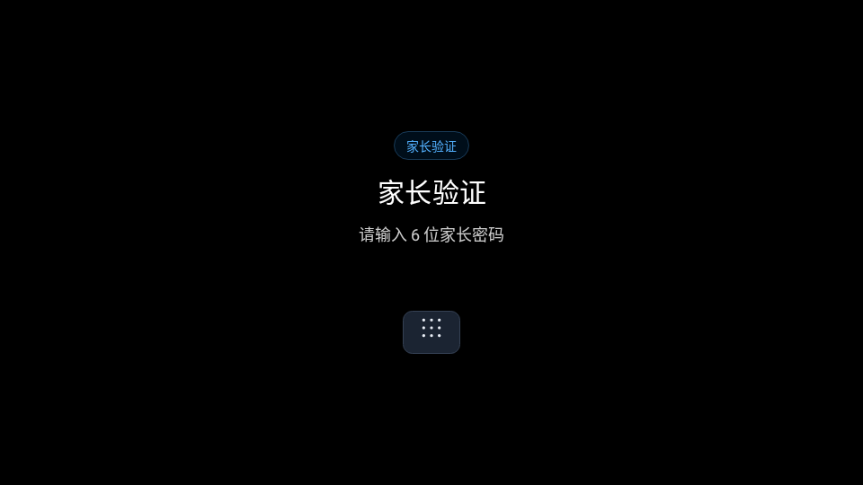

# TV Kids Guard · 电视时长管控

给安卓电视设置每天能看的时长。默认 30 分钟，用完自动锁屏，家长用遥控器管理。

[下载 APK](https://github.com/zzusec/tv-kids-guard/releases/latest/download/tv-kids-guard.apk) · [版本记录](https://github.com/zzusec/tv-kids-guard/releases) · [反馈问题](https://github.com/zzusec/tv-kids-guard/issues)

## 截图

### 家长面板


### 遥控器数字键无法确认时



### 展开后的屏幕数字盘


### 有实体数字键遥控器输入


### 每天 30 分钟用完后


以上截图均为应用原生渲染预览，使用示例数据。

## 安装

需要 Android 4.4（API 19）及以上，遥控器有方向键、OK 和返回键即可；遥控器没有数字键、或电视报不出数字键时，按屏幕上的数字键盘图标即可展开数字键盘。

1. 下载 APK，通过 U 盘或 ADB 安装。
2. 首次输入出厂密码 `000000`，再设置自己的 6 位家长密码。
3. 开启悬浮窗、无障碍服务，并允许应用在后台运行。

## 遥控操作

进入家长面板后，用方向键选择操作、按 OK 执行；有数字键的遥控器也可直接输入两位快捷码。

| 快捷码 | 操作 | 说明 |
| --- | --- | --- |
| `00` | 关闭面板 | 退到电视机桌面，不改变防护状态；与返回键同一条出路 |
| `11` | 改密码 | 再次验证后设置新密码 |
| `12` | 修改每日时长 | 每天 1–1440 分钟 |
| `13` | 检查更新 | 下载并安装正式版更新 |
| `22` | 临时加时长 | 只加今天，每天累计最多 60 分钟 |
| `33` | 立即锁定 | 马上锁屏，重新按当天额度限时 |
| `44` | 关闭防护 | 确认后停止管控，保留时长和密码 |
| `55` | 开启防卸载 | 启用设备管理员，增加直接卸载限制；仍需设置保护 |
| `99` | 启用防护 | 恢复普通管控，仅停用时显示 |
| `77` | 清零今天已看 | 把今天已看归零，每日额度与临时加时一个不动；正在锁屏就随之解除 |

- 输入方式：把所有非虚拟键盘或方向键 `InputDevice` 的数字键能力**合并**判断——各设备报告的普通数字键与小键盘数字键并集覆盖 0–9，就只用遥控器直接输入，屏幕上既没有数字盘也没有图标；并集缺一字或检测结果未知时，不再自动摊开一块数字盘，而是在输入区下方留一个数字键盘图标，不按电视或遥控器品牌判断。
- 图标点开数字盘：方向键从输入区（锁屏是「家长管理」按钮）按下或向右选中图标，按 OK 展开数字盘，图标同时收起。数字盘只属于当前这一屏，换一屏重新从图标开始；一旦真的收到来自非虚拟设备的数字按键，图标和数字盘一起永久退场。
- 实测优先：一旦有数字按键真的从非虚拟设备送达（哪怕它的 keymap 没报数字键），就在本机 `tvguard_remote` 记下 `physical_digits_seen`，此后连图标都不再出现。屏幕数字盘自己产生的按键和虚拟设备不算证据。
- 数字盘不能用时图标也不出现：连续输错进入冷却、或服务正在恢复时，数字盘被禁用，图标跟着收起，方向键仍停在原来的入口，不会让家长点开一个不能用的盘。
- 2.5.13 起没有手动切换：系统 keymap 不一定对应遥控器实际按键，早期版本因此在每个输入页放了「使用屏幕数字盘」「使用遥控器数字键」按钮。实测下来这颗按钮在已经能正常输入时被家长当成多余的选项，于是整颗删除——输入方式只由硬件决定，任何页面都不再有切换按钮，也不再响应任何组合键。旧版写在 `tvguard_remote` 里的 `show_keypad`、`pad_pinned` 在升级后第一次读取时被清掉，不会把数字盘留在屏幕上。2.5.14 进一步把「检测不出来就铺一屏数字盘」改成图标：数字盘还在，但只在你按它的时候出现。
- 家长验证与输入弹窗：检测到数字键时默认聚焦输入区，直接按遥控器数字键输入；未判定时同样聚焦输入区，要用数字盘就按下键选中图标展开。
- 展开数字盘后：用方向键在盘上选择数字，按 OK 输入；选择屏幕上的「删除」或「确认」按钮，再按 OK 执行。
- 有实体数字键：保留直接输入，输入后左方向键删除、OK 直接确认。
- 返回键取消当前输入。家长密码为 6 位且始终遮罩，时长显示数字，数字盘输入后选择「确认」保存；两种输入方式均不依赖系统输入法（IME）。家长验证、首次设置和修改密码、到时锁屏、每日时长与临时加时都按同一套硬件判定选择其中一种输入方式。

锁屏默认聚焦「家长管理」按钮，按 OK 进入家长验证，验证后打开面板，不自动解除当天限时。检测到遥控器有数字键时屏幕上没有数字盘也没有图标，直接按遥控器数字键输入即可，锁屏在任何焦点位置都收得到数字；数字键未判定时，从「家长管理」按钮按方向下或右选中数字键盘图标，按 OK 才展开数字盘。在锁屏上直接输入家长密码并确认，同样只打开家长管理面板：密码只证明家长在场，不送出一天的时长；面板本身不解除当天限时，退出面板才给出下面那段家长宽限。返回取消输入不会解除锁定。想让孩子多看一会儿，只能用管理面板的 `22 临时加时长` 或 `12 修改每日时长`，两者都不清空今天已看时长。

从家长面板按返回键（或 `00 关闭面板`）会退到电视机自己的桌面，并给出一次「家长宽限」：家长刚输入过正确密码，就是家长在场的证明，到本次宽限结束之前锁屏不再抢前台。2.5.15 的那份豁免只有桌面一屏宽，桌面之外的第一个窗口就把它花掉，于是家长退出后台再进任何一个 APP 都重新被索要密码，这台 Sony 上反馈的就是这个死循环。现在宽限不因离开桌面而结束；它只由下面几件事结束：按遥控器关机或电视自己进入待机、面板里 `33 立即锁定`、跨到新的一天、或者电视被断电重开。宽限不送时长也不改数字：每日额度、临时加时、今天已看的算法完全不变，宽限期内面板亮着的分钟照常计入今天已看，右上角显示「剩余 00:00」；孩子自己在锁屏上按 HOME 或返回换不来宽限（没有家长输入过密码就没有宽限）。

设置页是另一条规则（2.5.18）：进入已识别的设置、应用详情或卸载页面要输入家长密码，而本次开机里最近一次正确密码之后的两分钟内不用再输。两分钟够家长站在遥控器前把设置翻完，又不足以变成一张通行证——密码输错不换窗口，改密码这一步要先把旧密码输对，两分钟从最近一次成功输入重新起算，电视断电重开就归零。宽限与这个窗口各管各的：宽限只管锁屏，窗口只管设置页，所以家长退出面板后额度用尽的锁屏不会再抢前台，而设置页在两分钟之后照样重新要密码。

面板第五行新增 `77 清零今天已看`：按 OK 立刻把今天已看归零，不再二次确认。它是给家长自己用的——在这台真电视上用真遥控器验收，一旦测试跑到额度用尽，锁屏就把整晚占住，那 30 分钟是全家真实的观看时间。清零只动「今天已看」这一个数字：每日额度、临时加时、锁定规则与计时口径都不变，清零后右上角立刻显示完整的一天，正在挂着的锁屏因为额度重新完整而自动解除；再往后看的每一分钟照常计入。它躲在家长会话后面，孩子在面板上按不到。

## 注意

- 防护开启时按亮屏时间计时，不是视频播放时长；关屏、待机和锁定时都暂停，次日清零。一条时长要两个部件同时说「屏幕亮着」才计入：电源管理，以及显示子系统报告的屏面板状态（doze、屏保、面板熄灭都不算在看）；后者从 Android 4.4W（API 20）起才存在，更早的设备只有电源管理这一个判据。遥控器待机后挂钟与开机时长都仍会继续走（Sony 在待机里持有自己的唤醒锁），所以不能靠时钟判定待机；即使某个计时周期被系统卡住，一次也最多补 4 秒。锁屏自己不再强制保持亮屏，电视用完时长后可以照常进入待机，重新亮屏先看到锁屏。
- 右上角角标是防护仍在运行的凭据：只要没有锁屏就显示「剩余 MM:SS」，最后 5 分钟变红。2.5.12 起不再有「今天不限时」这一状态，角标也就永远不会换成一句「不限时」提示；孩子看不到空白角标，也就不会把它当成「防护关了」。
- 更新请覆盖安装，不要卸载或清除数据。Actions 中的 `community-debug` 包不能覆盖正式版。
- 日常保护依靠家长密码、到时锁屏和无障碍设置拦截：点击图标先验证，进入已识别的设置、应用详情或卸载页面时弹出验证页，返回不会露出原设置页。设置页要重新输入家长密码，已授权的会话不作为通行证，只有本次开机里最近一次正确密码之后的两分钟内不用再输（2.5.18）；两分钟从最近一次成功输入重新起算，输错密码、断电重开都不发放或延长它。只有家长验证页或管理面板正在屏幕上、或短时维护授权期间，拦截服务才不动手，因此不会出现「输入密码后又被要求输入密码」的循环。另一条让步是家长刚退出面板那一次宽限：到待机、`33 立即锁定`、新一天或断电之前锁屏不再抢前台，但这段时间照常计入今天已看，额度一个不多，且它不再放行设置页——设置页只看那两分钟。锁屏规则不变：在锁屏输入家长密码只打开家长管理面板，不送出一天的时长；管理面板按 `33 立即锁定` 重新锁屏并花掉这次宽限。面板的 `77 清零今天已看` 只把今天已看归零，每日额度与临时加时不动，清零后正在挂着的锁屏随之解除。
- 无障碍服务重连及定时检查会查询当前窗口所属包名，恢复已打开页面的保护；不遍历控件，不读取、保存或上传界面文字。页面识别失败会重试；面板区分权限未开启、服务未连接和查询失败，不能把启用列表当作实际运行状态。升级后请家长确认无障碍服务正常连接；若被系统关闭，普通应用不能自行重新开启。
- `55 开启防卸载` 是附加保护，由家长在系统确认页启用普通设备管理员。管理员仍启用时，系统拒绝直接卸载，但部分设置页可以先停用管理员再卸载；停用后的密码提示不能撤销该操作。因此必须保持设置拦截正常，不能把普通管理员当成系统级密码卸载锁。
- 本轮不要求 root、刷机、系统预装或 Device Owner。普通保护不保证阻止系统强停、清除数据或厂商未覆盖的卸载入口，安装后须检查实际电视的桌面长按和应用管理入口。
- 关闭防护会解除设备管理员；再次启用防护不会自动恢复该身份，需要重新按 `55`。Android 4.4 同样支持设备管理员，但没有系统 Lock Task，不能承诺系统级防绕过。更新由旧版系统安装器确认，不会静默安装。
- 数据保存在电视本地，无需注册账号；更新需要连接 GitHub。不同厂商的后台限制可能影响计时，请安装后验证。

本轮版本为 2.5.18（versionCode 49），落实家长提的两条优化。第一条是设置页的密码：2.5.9 的「每次进入设置都要输入家长密码」在实际用起来太碎——家长为了改一个网络设置连着输了几次密码，现在规则改成每次进入设置仍然要密码，但本次开机里最近一次正确密码之后的两分钟内不用再输，两分钟从任何一次成功输入重新起算，输错不算、改密码不算（那一步本来就要先把旧密码输对）、断电重开归零；2.5.17 的家长宽限因此不再放行设置页，只管额度用尽后的锁屏，两条规则各管各的屏。第二条是面板第五行 `77 清零今天已看`：这台电视要靠真遥控器验收，测试一旦跑过额度，锁屏就把整晚占住，那 30 分钟是全家真实的观看时间；按 OK 立即清零、不再二次确认，只动「今天已看」，每日额度与临时加时一个数字都不改，额度重新完整后正在挂着的锁屏自动解除，之后的每一分钟照常计入。2.5.17 的家长宽限、2.5.16 的待机双判据、2.5.14 的数字键盘图标、2.5.12 的「家长密码不送时长」、2.5.11 的数字键识别、2.5.10 的待机不计入当天时长，以及 2.5.9 的防验证死循环都保留。小米电视 2（MiTV2-40）的实机安装与遥控验收仍待 ADB 恢复后完成。

## 开发

使用 JDK 17、Android SDK 35 和 Python 3。

```bash
./gradlew testDebugUnitTest assembleDebug
python3 -I -B -m unittest discover -s tools -p 'test_*.py' -v
python3 -I -B tools/md_to_html.py
```

详见 [开发与发布说明](docs/开发说明.md)、[产品说明](PRODUCT.md) 和 [设计规范](DESIGN.md)。

[MIT License](LICENSE)。管理面板参考 [Preline](https://github.com/htmlstreamofficial/preline)，使用 Android 原生控件实现。
