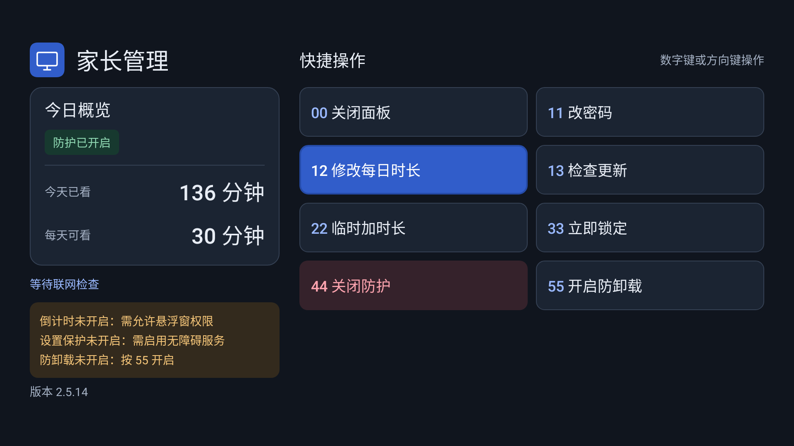
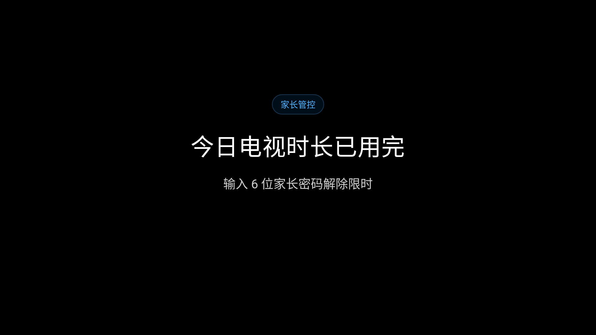

# TV Kids Guard · 电视时长管控

给安卓电视设置每天能看的时长。默认 30 分钟，用完自动锁屏，家长用遥控器管理。

[下载 APK](https://github.com/zzusec/tv-kids-guard/releases/latest/download/tv-kids-guard.apk) · [版本记录](https://github.com/zzusec/tv-kids-guard/releases) · [反馈问题](https://github.com/zzusec/tv-kids-guard/issues)

## 截图

### 家长面板



### 每天 30 分钟用完后



两图均为应用原生渲染预览，使用示例数据。

## 安装

需要 Android 5.0 及以上，遥控器须有数字键、方向键、OK 和返回键。

1. 下载 APK，通过 U 盘或 ADB 安装。
2. 首次输入出厂密码 `000000`，再设置自己的 6 位家长密码。
3. 开启悬浮窗、无障碍服务，并允许应用在后台运行。

## 遥控操作

进入家长面板后，直接输入两位快捷码，或用方向键选择、按 OK 执行。

| 快捷码 | 操作 | 说明 |
| --- | --- | --- |
| `00` | 关闭面板 | 只退出页面，不改变防护状态 |
| `11` | 改密码 | 再次验证后设置新密码 |
| `12` | 修改每日时长 | 每天 1–1440 分钟 |
| `13` | 检查更新 | 下载并安装正式版更新 |
| `22` | 临时加时长 | 只加今天，每天累计最多 60 分钟 |
| `33` | 立即锁定 | 马上锁屏，取消“今天不限时” |
| `44` | 关闭防护 | 确认后停止管控，保留时长和密码 |
| `99` | 启用防护 | 恢复普通管控，仅停用时显示 |

密码满 6 位自动提交，左方向键删除；时长输入后按 OK 保存。

锁屏时，按 OK 验证后进入后台；直接输入家长密码则**今天不限时**，次日恢复。修改每日时长或临时加时也会恢复限时，但不会清空今天已看时长。

## 注意

- 防护开启时按亮屏时间计时，不是视频播放时长；关屏和锁定时暂停，次日清零。
- 更新请覆盖安装，不要卸载或清除数据。Actions 中的 `community-debug` 包不能覆盖正式版。
- 普通安装不能保证防卸载、强停，Device Owner 取决于电视支持。关闭防护会尝试解除设备管理身份，再启用不会自动恢复该身份。
- 数据保存在电视本地，无需注册账号；更新需要连接 GitHub。不同厂商的后台限制可能影响计时，请安装后验证。

## 开发

使用 JDK 17、Android SDK 35 和 Python 3。

```bash
./gradlew testDebugUnitTest assembleDebug
python3 -I -B -m unittest discover -s tools -p 'test_*.py' -v
python3 -I -B tools/md_to_html.py
```

详见 [开发与发布说明](docs/开发说明.md)、[产品说明](PRODUCT.md) 和 [设计规范](DESIGN.md)。

[MIT License](LICENSE)。管理面板参考 [Preline](https://github.com/htmlstreamofficial/preline)，使用 Android 原生控件实现。
